# คู่มือการใช้งาน HIOKI Data Logger

ระบบวัดค่าความต้านทานพร้อมตัดสิน PASS / FAIL และบันทึกผลลงฐานข้อมูลอัตโนมัติ
สำหรับจอสัมผัส 10.1 นิ้ว (1280×800) ที่สถานีตรวจสอบคุณภาพ

> **สำหรับใคร:** พนักงานวัดค่าประจำไลน์ (หัวข้อ 1–8) และหัวหน้าไลน์ / วิศวกรที่ดูแลสเปค (หัวข้อ 9–13)
> ข้อความบนหน้าจอเป็นภาษาอังกฤษ — คู่มือนี้เขียนชื่อปุ่ม/ข้อความตามที่เห็นบนจอจริง เช่น **`Edit spec`**

## สารบัญ

1. [ภาพรวมหน้าจอ](#1-ภาพรวมหน้าจอ)
2. [เริ่มต้นใช้งาน](#2-เริ่มต้นใช้งาน)
3. [เลือกรุ่นงาน (Model)](#3-เลือกรุ่นงาน-model)
4. [การวัดค่า](#4-การวัดค่า)
5. [โหมดแสดงค่าเมื่อยกโพรบ: Hold / Release](#5-โหมดแสดงค่าเมื่อยกโพรบ-hold--release)
6. [การ์ดจุดวัดและผลตัดสิน](#6-การ์ดจุดวัดและผลตัดสิน)
7. [แถบสถานะด้านบน](#7-แถบสถานะด้านบน)
8. [ปุ่มเครื่องมือ](#8-ปุ่มเครื่องมือ)
9. [แก้ไขสเปค / ลงทะเบียนรุ่นใหม่](#9-แก้ไขสเปค--ลงทะเบียนรุ่นใหม่)
10. [โหมดช่วงเดียว (ไม่มีลำดับจุดวัด)](#10-โหมดช่วงเดียว-ไม่มีลำดับจุดวัด)
11. [การบันทึกข้อมูลและการอัปโหลด](#11-การบันทึกข้อมูลและการอัปโหลด)
12. [การแก้ปัญหาเบื้องต้น](#12-การแก้ปัญหาเบื้องต้น)
13. [สำหรับผู้ดูแลระบบ](#13-สำหรับผู้ดูแลระบบ)

---

## 1. ภาพรวมหน้าจอ

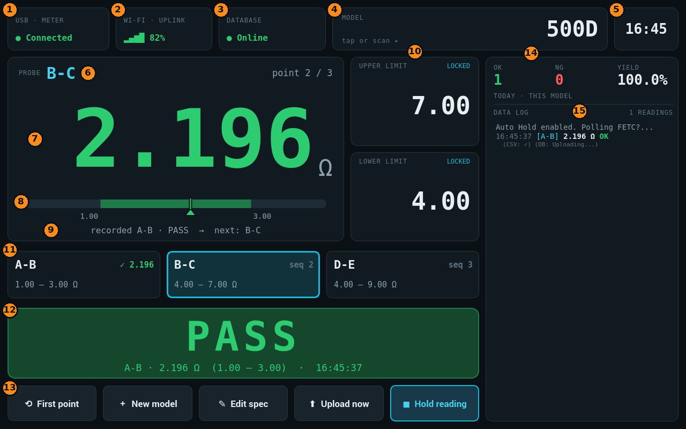

| # | ส่วนของหน้าจอ | หน้าที่ |
|---|---|---|
| 1 | **USB · METER** | สถานะการเชื่อมต่อเครื่องวัด HIOKI |
| 2 | **WI-FI · UPLINK** | ความแรงสัญญาณ Wi-Fi |
| 3 | **DATABASE** | สถานะฐานข้อมูล และจำนวนข้อมูลที่รออัปโหลด |
| 4 | **MODEL** | รุ่นงานที่กำลังวัด — **แตะเพื่อเปลี่ยนรุ่น** หรือสแกนบาร์โค้ด |
| 5 | นาฬิกา | เวลาปัจจุบัน |
| 6 | **PROBE** | **จุดที่ต้องวัดถัดไป** (เช่น B-C) และลำดับ `point 2 / 3` |
| 7 | ค่าที่วัดได้ (Ω) | ตัวเลขใหญ่ — **สีบอกสถานะ** (ดูหัวข้อ 4) |
| 8 | แถบช่วงสเปค | แถบสีเขียว = ช่วงที่ผ่าน, ลูกศร = ตำแหน่งค่าที่วัดได้ |
| 9 | บรรทัดสถานะ | อธิบายว่ากำลังเกิดอะไรขึ้น เช่น `recorded A-B · PASS → next: B-C` |
| 10 | **UPPER / LOWER LIMIT** | ค่าสเปคสูงสุด / ต่ำสุดของจุดที่กำลังวัด |
| 11 | การ์ดจุดวัด | แต่ละจุดในลำดับ พร้อมผล ✓ / ✗ ของชิ้นงานปัจจุบัน — แตะเพื่อข้ามไปจุดนั้น |
| 12 | ผลตัดสิน | **PASS** (เขียว) / **FAIL** (แดง) พร้อมจุด ค่า ช่วงสเปค และเวลา |
| 13 | ปุ่มเครื่องมือ | ดูหัวข้อ 8 |
| 14 | ตัวนับ **OK / NG / YIELD** | จำนวนชิ้นผ่าน / ไม่ผ่าน และ % ผ่าน ของ **วันนี้ เฉพาะรุ่นนี้** |
| 15 | **DATA LOG** | ประวัติการวัดและข้อความระบบ (ใหม่สุดอยู่ล่างสุด) |

**การใช้งานจอสัมผัส:** แตะด้วยปลายนิ้วได้ทุกปุ่ม · รายการ DATA LOG และการ์ดจุดวัด (เมื่อมีหลายจุด) **ลากนิ้วเพื่อเลื่อน**

---

## 2. เริ่มต้นใช้งาน

1. เปิดเครื่อง — โปรแกรมเปิดขึ้นเองเต็มจอ ไม่ต้องกดอะไร
2. เสียบสาย USB ของเครื่องวัด HIOKI — ระบบค้นหาเครื่องวัดเองอัตโนมัติ
3. รอจน **USB · METER** แสดง **`● Connected`** (สีเขียว) — ระบบพร้อมวัดทันที
4. ตรวจสอบว่า **MODEL** (หมายเลข 4) เป็นรุ่นงานที่ถูกต้อง ถ้าไม่ใช่ ให้เปลี่ยนตามหัวข้อ 3

> ระบบจำรุ่นงานล่าสุดไว้ เปิดเครื่องครั้งต่อไปจะใช้รุ่นเดิมโดยอัตโนมัติ (แม้ไฟดับหรือเครื่องรีสตาร์ท)

---

## 3. เลือกรุ่นงาน (Model)

มี 2 วิธี:

**วิธีที่ 1 — สแกนบาร์โค้ด (แนะนำ)**
สแกนบาร์โค้ดของชิ้นงานได้ทันทีที่หน้าจอหลัก ไม่ต้องแตะอะไรก่อน ระบบจะอ่านชื่อรุ่นจากบาร์โค้ด
(รองรับรูปแบบ Code 39 และแบบมีเครื่องหมาย `$` คั่น) แล้วโหลดสเปคของรุ่นนั้นทันที

**วิธีที่ 2 — พิมพ์เอง**
แตะการ์ด **MODEL** → แป้นพิมพ์บนจอจะแสดงขึ้น → พิมพ์ชื่อรุ่น → แตะ **`OK`**

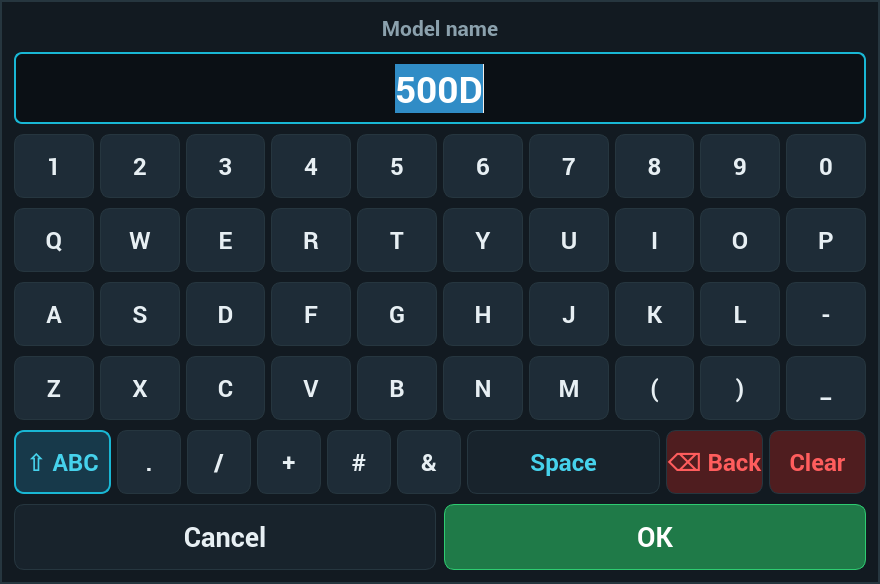

| ปุ่ม | หน้าที่ |
|---|---|
| **`⇧ ABC`** / **`⇧ abc`** | สลับตัวพิมพ์ใหญ่ / เล็ก (ค่าเริ่มต้นเป็นตัวพิมพ์ใหญ่) |
| **`Space`** | เว้นวรรค |
| **`⌫ Back`** | ลบทีละตัว |
| **`Clear`** | ลบทั้งหมด |
| **`OK`** / **`Cancel`** | ยืนยัน / ยกเลิก |

> ขณะแป้นพิมพ์เปิดอยู่ สามารถสแกนบาร์โค้ดใส่ช่องพิมพ์ได้เลย

เมื่อเปลี่ยนรุ่น: ค่าสเปค การ์ดจุดวัด และตัวนับ OK/NG จะเปลี่ยนเป็นของรุ่นใหม่ และผลตัดสินจะกลับเป็น `— — —` (`no reading yet for this model`)

---

## 4. การวัดค่า

### ขั้นตอน

1. ดู **PROBE** (หมายเลข 6) ว่าต้องวัดจุดไหน เช่น **`A-B`**
2. แตะโพรบที่จุดนั้น **ค้างไว้นิ่ง ๆ** จนตัวเลขเปลี่ยนเป็นสีเขียวหรือแดง (ประมาณ 1 วินาที)
3. ระบบจะ **บันทึกผลเอง** ตัดสิน PASS / FAIL พร้อมเสียงแจ้งเตือนภาษาไทย แล้ว **เลื่อนไปจุดถัดไปอัตโนมัติ**
4. ยกโพรบ แล้ววัดจุดถัดไปตามที่ **PROBE** แสดง
5. วัดครบจุดสุดท้ายแล้ว ระบบจะวนกลับไปจุดแรกสำหรับชิ้นงานถัดไป

```
 วัด A-B ──► ตัดสินด้วยสเปค A-B ──► บันทึก ──► ไปจุด B-C
 วัด B-C ──► ตัดสินด้วยสเปค B-C ──► บันทึก ──► ไปจุด D-E
 วัด D-E ──► ตัดสินด้วยสเปค D-E ──► บันทึก ──► วนกลับ A-B (ชิ้นถัดไป)
```

> **ไม่ต้องกดปุ่มใด ๆ ระหว่างวัด** — ระบบบันทึกเมื่ออ่านค่าเดิมได้ 2 ครั้งติดกัน (ค่านิ่ง)
> และบันทึกเพียงครั้งเดียวต่อการแตะโพรบหนึ่งครั้ง

### สีของค่าที่วัดได้

| สี | ความหมาย | ตัวอย่าง |
|---|---|---|
| เทา `-.---` | พร้อมวัด ยังไม่มีค่า | 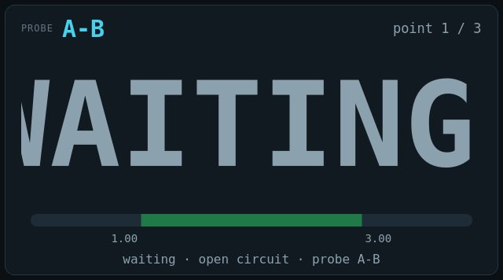 |
| **เหลือง / ส้ม** | ค่ากำลังนิ่ง (`settling…`) — **ถือโพรบค้างไว้** | 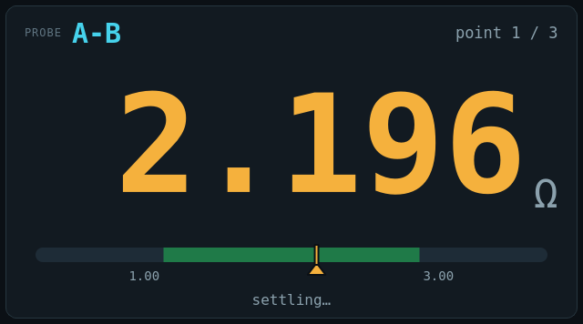 |
| **เขียว** | บันทึกแล้ว — **ผ่าน** สเปค | 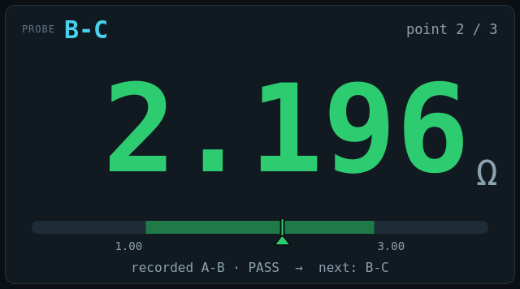 |
| **แดง** | บันทึกแล้ว — **ไม่ผ่าน** สเปค | 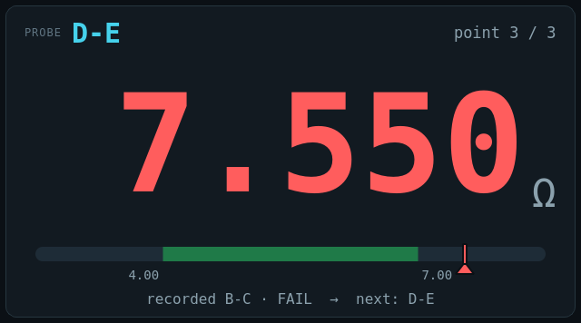 |

**แถบช่วงสเปค** ใต้ตัวเลขช่วยให้เห็นว่าค่าใกล้ขอบสเปคแค่ไหน — ลูกศรอยู่ในแถบสีเขียว = ผ่าน, อยู่นอกแถบ = ไม่ผ่าน

> **สำคัญ:** หลังบันทึก หัวข้อ **PROBE** จะเปลี่ยนเป็น **จุดถัดไปทันที** แต่ตัวเลขยังเป็นค่าของ **จุดที่เพิ่งวัด**
> ให้อ่านบรรทัดสถานะ เช่น `recorded A-B · PASS → next: B-C` = เพิ่งบันทึก A-B ว่าผ่าน ต่อไปให้วัด B-C

---

## 5. โหมดแสดงค่าเมื่อยกโพรบ: Hold / Release

เลือกด้วยปุ่มขวาสุดของแถวปุ่มเครื่องมือ (ปุ่ม E หัวข้อ 8) ระบบจำค่าที่เลือกไว้แม้ปิดเครื่อง

| โหมด | ปุ่มแสดง | เมื่อยกโพรบ (วงจรเปิด) | ตัวอย่าง |
|---|---|---|---|
| **Hold** (ค่าเริ่มต้น) | **`◼ Hold reading`** (กรอบสีฟ้า) | ค้างค่าล่าสุดไว้เป็น **สีเทา** — `waiting · open circuit · … · holding last reading` | 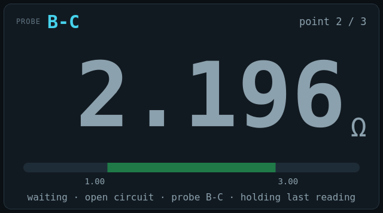 |
| **Release** | **`↧ Release`** | แสดงค่าที่บันทึก **3 วินาที** แล้วเปลี่ยนเป็น **`WAITING`** | 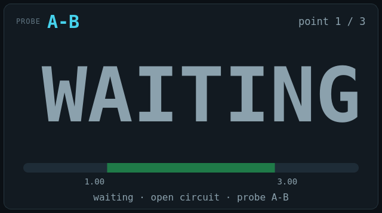 |

> ในโหมด Release ถ้าถือโพรบค้างนานเกิน 3 วินาทีหลังบันทึก จอก็จะแสดง `WAITING` เช่นกัน
> (เครื่องวัดค้างค่าเดิมไว้ ระบบจึงแยกไม่ออกว่ายังแตะอยู่หรือยกแล้ว) — **ผลที่บันทึกไม่หาย** ยังดูได้ที่แถบผลตัดสินและการ์ดจุดวัด

---

## 6. การ์ดจุดวัดและผลตัดสิน

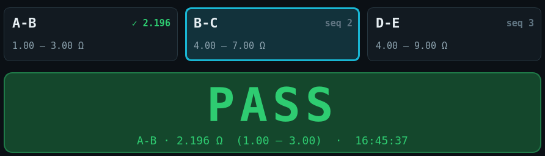

**การ์ดจุดวัด** (หนึ่งใบต่อหนึ่งจุด เรียงตามลำดับการวัด)

- การ์ดที่มี **กรอบสีฟ้า** = จุดที่ต้องวัดตอนนี้
- มุมขวาบนแสดงผลของ **ชิ้นงานปัจจุบัน**: **`✓ 2.196`** (เขียว = ผ่าน), **`✗ 7.550`** (แดง = ไม่ผ่าน), `seq 2` = ยังไม่ได้วัด
- เมื่อเริ่มวัดจุดแรกของชิ้นใหม่ เครื่องหมายของชิ้นก่อนจะถูกล้าง
- **แตะการ์ด** เพื่อข้ามไปวัดจุดนั้นโดยตรง (เช่น ต้องการวัดซ้ำจุดที่ไม่ผ่าน)
- ถ้ามีมากกว่า 4 จุด **ลากนิ้วซ้าย-ขวา** เพื่อเลื่อนดู

**แถบผลตัดสิน** แสดง **PASS** (พื้นเขียว) หรือ **FAIL** (พื้นแดง) ตัวใหญ่ พร้อมรายละเอียด
`จุด · ค่าที่วัด Ω (สเปคต่ำ – สเปคสูง) · เวลา` ของการวัดล่าสุด

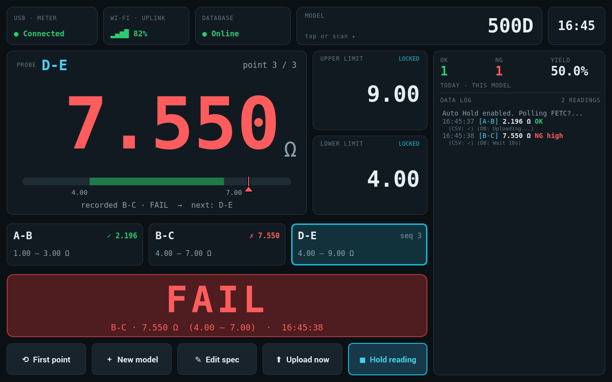

> ตัวอย่างด้านบน: จุด B-C วัดได้ 7.550 Ω เกินสเปค 4.00–7.00 → **FAIL** และการ์ด B-C แสดง ✗ — ระบบเลื่อนไปจุด D-E แล้ว
> ถ้าต้องการวัด B-C ซ้ำ ให้ **แตะการ์ด B-C** ก่อน

---

## 7. แถบสถานะด้านบน


| ช่อง | สถานะ | ความหมาย / สิ่งที่ต้องทำ |
|---|---|---|
| **USB · METER** | **`● Connected`** เขียว | เชื่อมต่อเครื่องวัดแล้ว พร้อมวัด |
| | **`◌ Connecting`** ส้ม | กำลังค้นหา / เชื่อมต่อใหม่ — รอสักครู่ |
| | **`○ Disconnected`** แดง | ไม่พบเครื่องวัด — ตรวจสายเครื่องวัด HIOKI และเปิดเครื่องวัด |
| **WI-FI · UPLINK** | `▂▄▆█ 82%` | เขียว ≥ 70% · ส้ม 40–69% · แดง < 40% · `○ ---` = ไม่มี Wi-Fi |
| **DATABASE** | **`● Online`** เขียว | ส่งข้อมูลเข้าฐานข้อมูลได้ปกติ |
| | **`⬆ 3 queued`** ส้ม | มีข้อมูล 3 รายการรอส่ง |
| | **`○ Offline · 3`** แดง | ติดต่อฐานข้อมูลไม่ได้ ข้อมูล 3 รายการเก็บไว้ในเครื่อง จะส่งเองเมื่อกลับมาออนไลน์ |


> **ฐานข้อมูลออฟไลน์ไม่ต้องหยุดงาน** — วัดต่อได้ตามปกติ ข้อมูลไม่หาย

---

## 8. ปุ่มเครื่องมือ


| ปุ่ม | ชื่อ | หน้าที่ |
|---|---|---|
| **A** | **`⟲ First point`** | กลับไปเริ่มที่จุดแรกของลำดับ (เช่น เปลี่ยนชิ้นงานกลางคัน) — กดไม่ได้ในโหมดช่วงเดียว |
| **B** | **`＋ New model`** | ลงทะเบียนรุ่นงานใหม่ (หัวข้อ 9) |
| **C** | **`✎ Edit spec`** | แก้ไขสเปคของรุ่นปัจจุบัน (หัวข้อ 9) |
| **D** | **`⬆ Upload now`** | ส่งข้อมูลที่ค้างอยู่เข้าฐานข้อมูลทันที ไม่ต้องรอรอบอัตโนมัติ |
| **E** | **`◼ Hold reading`** / **`↧ Release`** | สลับโหมดแสดงค่าเมื่อยกโพรบ (หัวข้อ 5) |

เมื่อมีข้อมูลค้างส่ง ปุ่ม **D** จะมี **กรอบสีส้ม** และแสดงจำนวน:


---

## 9. แก้ไขสเปค / ลงทะเบียนรุ่นใหม่

> สำหรับหัวหน้าไลน์ / วิศวกร — สเปคที่บันทึกจะใช้กับทุกเครื่องที่ใช้ฐานข้อมูลเดียวกัน

- **`＋ New model`** — เปิดหน้าต่างเปล่าสำหรับรุ่นใหม่
- **`✎ Edit spec`** — เปิดหน้าต่างพร้อมสเปคของรุ่นปัจจุบัน

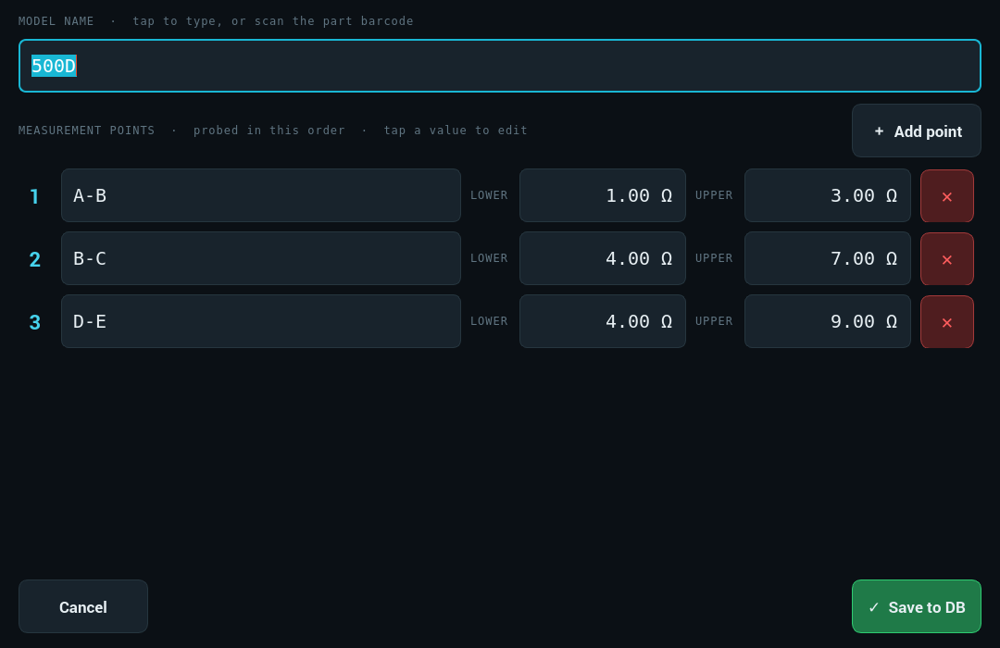

**ขั้นตอน**

1. **MODEL NAME** — แตะช่องเพื่อพิมพ์ด้วยแป้นพิมพ์บนจอ หรือสแกนบาร์โค้ดของชิ้นงาน
2. แต่ละแถว = หนึ่งจุดวัด **เรียงตามลำดับที่ต้องวัด** (เลข 1, 2, 3 ด้านซ้าย)
   - ช่องชื่อ — แตะเพื่อพิมพ์ชื่อจุด เช่น `A-B`
   - ช่อง **LOWER** / **UPPER** — แตะเพื่อใส่ค่าด้วยแป้นตัวเลข (หน่วย Ω, ทศนิยม 2 ตำแหน่ง)
   - **`✕`** (สีแดง) — ลบแถวนั้น
3. **`＋ Add point`** — เพิ่มจุดวัดต่อท้าย
4. แตะ **`✓ Save to DB`** เพื่อบันทึก (หรือ **`Cancel`** เพื่อยกเลิก)
5. ถ้าเป็นรุ่นอื่นที่ไม่ใช่รุ่นปัจจุบัน ระบบจะถาม `Switch to this model now?` → แตะ **Yes** เพื่อเริ่มวัดรุ่นนั้นทันที

**แป้นตัวเลข**

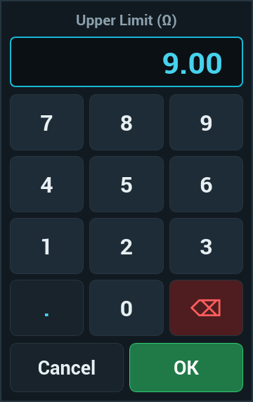

- กดตัวเลขตัวแรก ค่าเดิมจะถูกล้างอัตโนมัติ · **`⌫`** ลบทีละตัว · **`.`** จุดทศนิยม
- ถ้าใส่ค่าเกินช่วงที่อนุญาต แตะ **`OK`** แล้วระบบจะปรับเป็นค่าขอบเขตให้ แตะ **`OK`** อีกครั้งเพื่อยืนยัน

**ระบบจะไม่ยอมบันทึก** (แสดงข้อความสีแดงใต้รายการ) เมื่อ:

| ข้อความ | สาเหตุ |
|---|---|
| `model name is required` | ไม่ได้ใส่ชื่อรุ่น |
| `add at least one measurement point` | ไม่มีจุดวัดเลย |
| `point N: name is required` | จุดที่ N ไม่มีชื่อ |
| `point N: duplicate name '…'` | ชื่อจุดซ้ำกัน |
| `point N (…): lower must be < upper` | ค่า LOWER ไม่น้อยกว่า UPPER |

> **ฐานข้อมูลออฟไลน์ขณะบันทึกสเปค:** ระบบแจ้ง `Spec queued` — สเปคใช้งานในเครื่องนี้ได้ทันที
> และจะส่งเข้าฐานข้อมูลเองเมื่อกลับมาออนไลน์

---

## 10. โหมดช่วงเดียว (ไม่มีลำดับจุดวัด)

รุ่นที่ไม่มีลำดับจุดวัดจะใช้สเปคช่วงเดียวกับทุกการวัด หัวข้อจะแสดง **`MEASURED single range`**

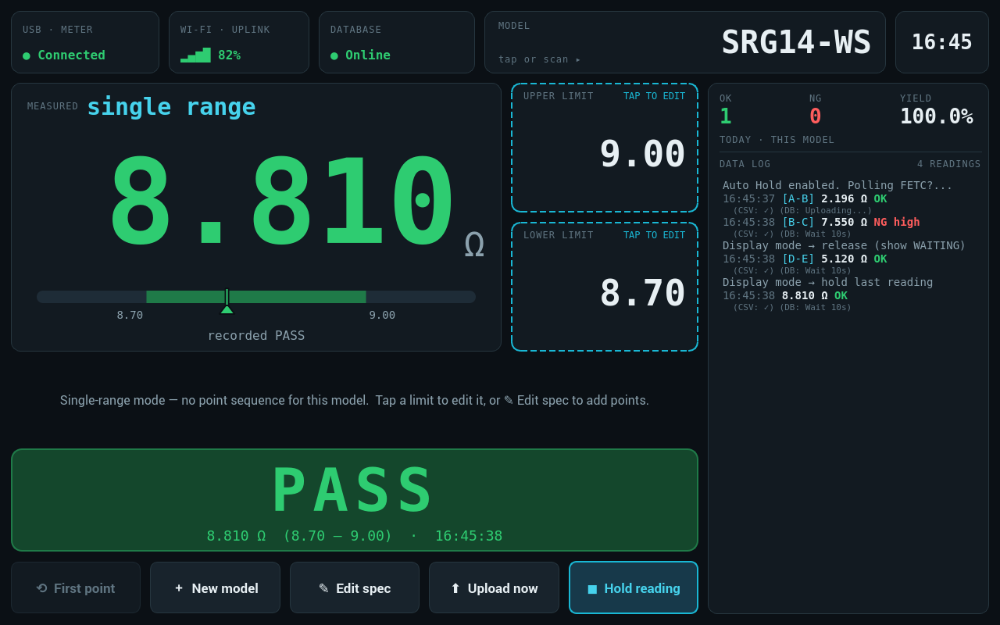

- ช่อง **UPPER / LOWER LIMIT** มีกรอบเส้นประสีฟ้าและป้าย **`TAP TO EDIT`** — **แตะเพื่อแก้ค่า** ด้วยแป้นตัวเลข
- ในรุ่นที่มีลำดับจุดวัด ช่องนี้แสดง **`LOCKED`** แก้ไม่ได้ (ต้องแก้ผ่าน **`✎ Edit spec`**)
- ถ้าต้องการเปลี่ยนเป็นแบบหลายจุด ให้กด **`✎ Edit spec`** แล้วเพิ่มจุดวัด

---

## 11. การบันทึกข้อมูลและการอัปโหลด

ทุกครั้งที่ระบบบันทึกผล:

1. **บันทึกลงไฟล์ในเครื่อง** (ไฟล์รายวัน `YYYYMMDD.csv`) — ข้อมูลไม่หายแม้ไม่มีเครือข่าย
2. **ส่งเข้าฐานข้อมูล** — ถ้าส่งไม่ได้จะเก็บคิวไว้และส่งซ้ำอัตโนมัติ
3. แสดงใน **DATA LOG** และนับเข้า **OK / NG / YIELD**

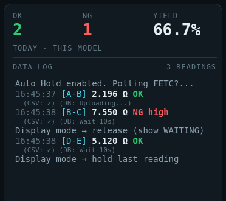

การอ่าน DATA LOG: `เวลา [จุด] ค่า Ω  OK/NG` และบรรทัดเล็กด้านล่างคือผลการบันทึก
(`CSV: ✓` = บันทึกไฟล์แล้ว, `DB: Uploading...` = กำลังส่งเข้าฐานข้อมูล)
ข้อความ **สีส้ม** ขึ้นต้นด้วย `!` = คำเตือน เช่น ฐานข้อมูลติดต่อไม่ได้

> **ข้อควรทราบ:** ผลที่บันทึกห่างจากการส่งครั้งก่อน **น้อยกว่า 5 วินาที** จะบันทึกลงไฟล์ CSV เท่านั้น
> ไม่ส่งเข้าฐานข้อมูล (DATA LOG แสดง `DB: Wait 10s`) — หากต้องการให้ทุกผลเข้าฐานข้อมูล ให้วัดแต่ละจุดห่างกันอย่างน้อย 5 วินาที

**ตัวนับ OK / NG / YIELD** นับเฉพาะ **วันนี้** และ **รุ่นปัจจุบัน** (อ่านจากไฟล์ CSV ของวันนี้เมื่อเปิดโปรแกรมหรือเปลี่ยนรุ่น) และเริ่มนับใหม่เมื่อขึ้นวันใหม่

---

## 12. การแก้ปัญหาเบื้องต้น

| อาการ | สาเหตุที่เป็นไปได้ | วิธีแก้ |
|---|---|---|
| **`○ Disconnected`** ค้าง | สายเครื่องวัดหลุด / เครื่องวัดปิด | ตรวจสาย USB และเปิดเครื่องวัด — ระบบเชื่อมต่อเองภายในไม่กี่วินาที ไม่ต้องปิดโปรแกรม |
| ตัวเลข **สีส้มค้าง** ไม่บันทึก | ค่ายังไม่นิ่ง / แตะโพรบไม่แน่น | กดโพรบให้แน่นและนิ่ง |
| วัดแล้ว **ไม่บันทึก** ทั้งที่ค่านิ่ง | ค่าเท่ากับครั้งก่อนพอดีโดยไม่ได้ยกโพรบ | ยกโพรบออกให้จอแสดง `waiting` ก่อน แล้ววัดใหม่ |
| ผลถูกตัดสินด้วย **จุดผิด** | ลำดับเลื่อนไปแล้ว | แตะการ์ดจุดที่ถูกต้อง หรือ **`⟲ First point`** |
| ขึ้นหน้าต่างให้พิมพ์ชื่อรุ่นตอนวัด | ยังไม่ได้ตั้งรุ่นงาน | พิมพ์ชื่อรุ่นหรือสแกนบาร์โค้ด แล้วแตะ **`OK`** |
| **`○ Offline`** ที่ DATABASE | เครือข่าย / เซิร์ฟเวอร์ฐานข้อมูลมีปัญหา | วัดต่อได้ ข้อมูลเก็บในเครื่อง — แจ้งฝ่าย IT ถ้านานผิดปกติ, กด **`⬆ Upload`** เมื่อกลับมาออนไลน์ |
| DATA LOG ขึ้น `⚠ Serial hardware hang — reconnecting…` | การสื่อสาร USB กับเครื่องวัดค้าง | ระบบกู้คืนเอง รอสักครู่ ถ้าไม่หายให้ถอด-เสียบสาย USB เครื่องวัด |
| `DB schema out of date` | ฐานข้อมูลยังไม่ได้อัปเดตโครงสร้าง | แจ้งผู้ดูแลระบบ (หัวข้อ 13) |
| ไม่มีเสียงแจ้ง PASS / FAIL | ลำโพง / ระดับเสียง | ตรวจลำโพงและระดับเสียงของเครื่อง |
| โปรแกรมค้าง / ปิดไปเอง | — | ระบบเฝ้าระวัง (watchdog) จะเปิดโปรแกรมใหม่เองภายในประมาณ 1–2 นาที |

---

## 13. สำหรับผู้ดูแลระบบ

**รีสตาร์ทโปรแกรม** (เช่น หลังอัปเดต):

```bash
sudo systemctl restart hioki-app
```

**ไฟล์สำคัญ** (ในโฟลเดอร์ `/home/pi/Hioki_data_logger`)

| ไฟล์ | เนื้อหา |
|---|---|
| `YYYYMMDD.csv` | ผลการวัดรายวัน |
| `gui_mode5_config.json` | รุ่นปัจจุบัน, โหมด Hold/Release, สเปคที่เก็บสำรองในเครื่อง |
| `pending_uploads.json` | ผลการวัดที่รอส่งเข้าฐานข้อมูล |
| `pending_specs.csv` | สเปคที่รอส่งเข้าฐานข้อมูล |
| `model_changes.csv` | ประวัติการเปลี่ยนรุ่นงาน (ใช้กู้คืนรุ่นล่าสุดหลังเครื่องดับ) |
| `watchdog.log` | บันทึกของระบบเฝ้าระวังที่รีสตาร์ทโปรแกรมเมื่อค้าง |

**คีย์ลัด** (ใช้คีย์บอร์ดจริง สำหรับทดสอบ): **Ctrl+P** แสดง PASS · **Ctrl+F** แสดง FAIL (ทดสอบหน้าจอและเสียง ไม่บันทึกข้อมูล)

**ปรับเวลา `WAITING` ในโหมด Release:** แก้ค่า `RELEASE_AFTER_S` (ค่าเริ่มต้น 3.0 วินาที) ในไฟล์ `main.py` แล้วรีสตาร์ทโปรแกรม

> รายละเอียดการติดตั้ง ฐานข้อมูล และการตั้งค่าเพิ่มเติม ดูที่ [README.md](README.md)
