# คู่มือการใช้งาน HIOKI Data Logger

ระบบวัดค่าความต้านทานพร้อมตัดสิน PASS / FAIL และบันทึกผลลงฐานข้อมูลอัตโนมัติ
สำหรับจอสัมผัส 10.1 นิ้ว (1280×800) ที่สถานีตรวจสอบคุณภาพ

> **สำหรับใคร:** พนักงานวัดค่าประจำไลน์ (หัวข้อ 1–9) และหัวหน้าไลน์ / วิศวกรที่ดูแลสเปค (หัวข้อ 10–14)
>
> **ภาษาหน้าจอ:** ค่าเริ่มต้นเป็น **ภาษาไทย** — เปลี่ยนเป็นภาษาอังกฤษได้ด้วยปุ่ม **TH | EN** ใต้นาฬิกา (หัวข้อ 2)
> คู่มือนี้เขียนชื่อปุ่ม/ข้อความตามที่เห็นในโหมด **TH** และใส่ชื่อในโหมด EN ไว้ในวงเล็บ เช่น **`✎ แก้ไขสเปค`** (`✎ Edit spec`)
> รูปตัวอย่างในคู่มือบางรูปถ่ายจากโหมด EN — ตำแหน่งปุ่มเหมือนกันทุกประการ

## สารบัญ

1. [ภาพรวมหน้าจอ](#1-ภาพรวมหน้าจอ)
2. [เลือกภาษาหน้าจอ (TH / EN)](#2-เลือกภาษาหน้าจอ-th--en)
3. [เริ่มต้นใช้งาน](#3-เริ่มต้นใช้งาน)
4. [เลือกรุ่นงาน (Model)](#4-เลือกรุ่นงาน-model)
5. [การวัดค่า](#5-การวัดค่า)
6. [โหมดแสดงค่าเมื่อยกโพรบ: ค้างค่า / ปล่อยค่า](#6-โหมดแสดงค่าเมื่อยกโพรบ-ค้างค่า--ปล่อยค่า)
7. [การ์ดจุดวัดและผลตัดสิน](#7-การ์ดจุดวัดและผลตัดสิน)
8. [แถบสถานะด้านบน](#8-แถบสถานะด้านบน)
9. [ปุ่มเครื่องมือ](#9-ปุ่มเครื่องมือ)
10. [แก้ไขสเปค / ลงทะเบียนรุ่นใหม่](#10-แก้ไขสเปค--ลงทะเบียนรุ่นใหม่)
11. [โหมดช่วงเดียว (ไม่มีลำดับจุดวัด)](#11-โหมดช่วงเดียว-ไม่มีลำดับจุดวัด)
12. [การบันทึกข้อมูลและการอัปโหลด](#12-การบันทึกข้อมูลและการอัปโหลด)
13. [การแก้ปัญหาเบื้องต้น](#13-การแก้ปัญหาเบื้องต้น)
14. [สำหรับผู้ดูแลระบบ](#14-สำหรับผู้ดูแลระบบ)

---

## 1. ภาพรวมหน้าจอ

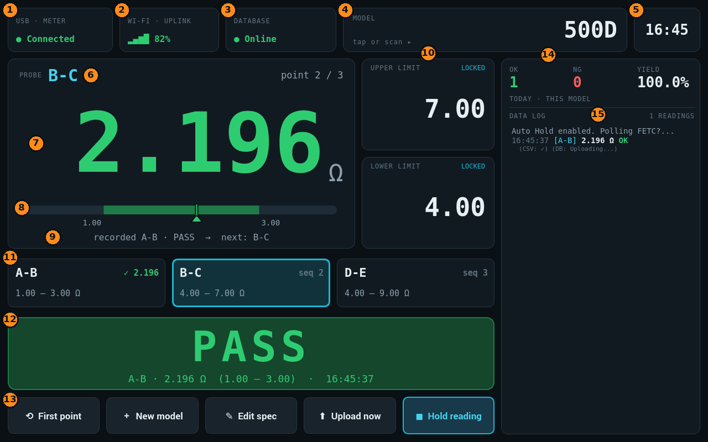

| # | ส่วนของหน้าจอ (TH / EN) | หน้าที่ |
|---|---|---|
| 1 | **USB · เครื่องวัด** (USB · METER) | สถานะการเชื่อมต่อเครื่องวัด HIOKI |
| 2 | **WI-FI · สัญญาณ** (WI-FI · UPLINK) | ความแรงสัญญาณ Wi-Fi |
| 3 | **ฐานข้อมูล** (DATABASE) | สถานะฐานข้อมูล และจำนวนข้อมูลที่รอส่ง |
| 4 | **รุ่นงาน** (MODEL) | รุ่นงานที่กำลังวัด — **แตะเพื่อเปลี่ยนรุ่น** หรือสแกนบาร์โค้ด |
| 5 | นาฬิกา และปุ่ม **TH \| EN** | เวลาปัจจุบัน และปุ่มเลือกภาษาหน้าจอ (หัวข้อ 2) |
| 6 | **จุดวัด** (PROBE) | **จุดที่ต้องวัดถัดไป** (เช่น B-C) และลำดับ `จุด 2 / 3` |
| 7 | ค่าที่วัดได้ (Ω) | ตัวเลขใหญ่ — **สีบอกสถานะ** (หัวข้อ 5) |
| 8 | แถบช่วงสเปค | แถบสีเขียว = ช่วงที่ผ่าน, ลูกศร = ตำแหน่งค่าที่วัดได้ |
| 9 | บรรทัดสถานะ | อธิบายว่ากำลังเกิดอะไรขึ้น เช่น `บันทึก A-B · PASS → ถัดไป: B-C` |
| 10 | **สเปคสูงสุด / สเปคต่ำสุด** (UPPER / LOWER LIMIT) | ค่าสเปคของจุดที่กำลังวัด |
| 11 | การ์ดจุดวัด | แต่ละจุดในลำดับ พร้อมผล ✓ / ✗ ของชิ้นงานปัจจุบัน — แตะเพื่อข้ามไปจุดนั้น |
| 12 | ผลตัดสิน | **PASS** (เขียว) / **FAIL** (แดง) พร้อมจุด ค่า ช่วงสเปค และเวลา |
| 13 | ปุ่มเครื่องมือ | หัวข้อ 9 |
| 14 | ตัวนับ **OK / NG / % ผ่าน** (YIELD) | จำนวนชิ้นผ่าน / ไม่ผ่าน และ % ผ่าน ของ **วันนี้ เฉพาะรุ่นนี้** |
| 15 | **บันทึกข้อมูล** (DATA LOG) | ประวัติการวัดและข้อความระบบ (ใหม่สุดอยู่ล่างสุด) |

**การใช้งานจอสัมผัส:** แตะด้วยปลายนิ้วได้ทุกปุ่ม · รายการบันทึกข้อมูลและการ์ดจุดวัด (เมื่อมีหลายจุด) **ลากนิ้วเพื่อเลื่อน**

**คำที่เป็นภาษาอังกฤษเสมอ** (ทั้งโหมด TH และ EN): ชื่อรุ่น, ชื่อจุดวัด, **PASS / FAIL / OK / NG**, **WAITING**, หน่วย Ω และแป้นพิมพ์บนจอ

---

## 2. เลือกภาษาหน้าจอ (TH / EN)

ใต้นาฬิกามุมขวาบนมีปุ่มเล็ก 2 ปุ่ม **TH** และ **EN** — ปุ่มที่มีกรอบสีฟ้าคือภาษาที่ใช้อยู่

- แตะ **TH** = ภาษาไทย (ค่าเริ่มต้น) · แตะ **EN** = ภาษาอังกฤษ
- หน้าจอเปลี่ยนภาษาทันที **ไม่ต้องรีสตาร์ท** และไม่กระทบการวัดที่กำลังทำอยู่
- ระบบ **จำภาษาที่เลือกไว้** แม้ปิดเครื่องหรือไฟดับ
- ข้อความในบันทึกข้อมูลที่ขึ้นไปแล้ว **คงภาษาเดิม** — ข้อความใหม่จะเป็นภาษาที่เลือก
- ข้อมูลที่บันทึกลงไฟล์ CSV และฐานข้อมูล **เหมือนเดิมทุกภาษา** (ชื่อรุ่น, จุดวัด, OK/NG)

---

## 3. เริ่มต้นใช้งาน

1. เปิดเครื่อง — โปรแกรมเปิดขึ้นเองเต็มจอ ไม่ต้องกดอะไร
2. เสียบสาย USB ของเครื่องวัด HIOKI — ระบบค้นหาเครื่องวัดเองอัตโนมัติ
3. รอจน **USB · เครื่องวัด** แสดง **`● เชื่อมต่อแล้ว`** (`● Connected`) สีเขียว — พร้อมวัดทันที
4. ตรวจสอบว่า **รุ่นงาน** (หมายเลข 4) ถูกต้อง ถ้าไม่ใช่ ให้เปลี่ยนตามหัวข้อ 4

> ระบบจำรุ่นงานล่าสุดไว้ เปิดเครื่องครั้งต่อไปจะใช้รุ่นเดิมโดยอัตโนมัติ (แม้ไฟดับหรือเครื่องรีสตาร์ท)
> ถ้ายังไม่เคยตั้งรุ่น ช่องรุ่นงานจะแสดง **`แตะเพื่อตั้งรุ่นงาน`** (`Tap to set model`) เป็นสีส้ม

---

## 4. เลือกรุ่นงาน (Model)

มี 2 วิธี:

**วิธีที่ 1 — สแกนบาร์โค้ด (แนะนำ)**
สแกนบาร์โค้ดของชิ้นงานได้ทันทีที่หน้าจอหลัก ไม่ต้องแตะอะไรก่อน ระบบจะอ่านชื่อรุ่นจากบาร์โค้ด
(รองรับรูปแบบ Code 39 และแบบมีเครื่องหมาย `$` คั่น) แล้วโหลดสเปคของรุ่นนั้นทันที

> **ระวัง QR code บนฉลาก มอก. (TISI):** ถ้าสแกนโดน QR ที่เป็นลิงก์ เช่น `https://ppdb.tisi.go.th/...`
> ระบบจะ **ไม่รับ** และใช้รุ่นเดิมต่อ บันทึกข้อมูลจะแสดง `ไม่รับบาร์โค้ด — เป็นลิงก์ URL/QR ไม่ใช่ชื่อรุ่น`
> ให้สแกนบาร์โค้ดชื่อรุ่นอีกครั้ง (ข้อความที่ยาวเกิน 50 ตัวอักษรก็จะไม่ถูกรับเป็นชื่อรุ่นเช่นกัน)

**วิธีที่ 2 — พิมพ์เอง**
แตะช่อง **รุ่นงาน** → แป้นพิมพ์บนจอจะแสดงขึ้น → พิมพ์ชื่อรุ่น → แตะ **`OK`**

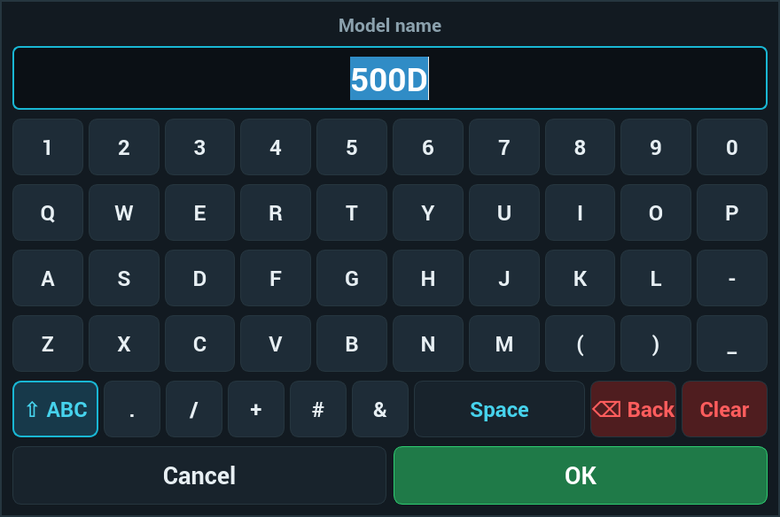

แป้นพิมพ์บนจอเป็น **ภาษาอังกฤษเสมอ** (ชื่อรุ่นและชื่อจุดวัดเป็นภาษาอังกฤษ):

| ปุ่ม | หน้าที่ |
|---|---|
| **`⇧ ABC`** / **`⇧ abc`** | สลับตัวพิมพ์ใหญ่ / เล็ก (ค่าเริ่มต้นเป็นตัวพิมพ์ใหญ่) |
| **`Space`** | เว้นวรรค |
| **`⌫ Back`** | ลบทีละตัว |
| **`Clear`** | ลบทั้งหมด |
| **`OK`** / **`Cancel`** | ยืนยัน / ยกเลิก |

> ขณะแป้นพิมพ์เปิดอยู่ สามารถสแกนบาร์โค้ดใส่ช่องพิมพ์ได้เลย

เมื่อเปลี่ยนรุ่น: ค่าสเปค การ์ดจุดวัด และตัวนับ OK/NG จะเปลี่ยนเป็นของรุ่นใหม่ และผลตัดสินจะกลับเป็น `— — —`
(`ยังไม่มีผลการวัดของรุ่นนี้`)

---

## 5. การวัดค่า

### ขั้นตอน

1. ดู **จุดวัด** (หมายเลข 6) ว่าต้องวัดจุดไหน เช่น **`A-B`**
2. แตะโพรบที่จุดนั้น **ค้างไว้นิ่ง ๆ** จนตัวเลขเปลี่ยนเป็นสีเขียวหรือแดง (ประมาณ 1 วินาที)
3. ระบบจะ **บันทึกผลเอง** ตัดสิน PASS / FAIL พร้อมเสียงแจ้งเตือนภาษาไทย แล้ว **เลื่อนไปจุดถัดไปอัตโนมัติ**
4. ยกโพรบ แล้ววัดจุดถัดไปตามที่ **จุดวัด** แสดง
5. วัดครบจุดสุดท้ายแล้ว ระบบจะวนกลับไปจุดแรกสำหรับชิ้นงานถัดไป

```
 วัด A-B ──► ตัดสินด้วยสเปค A-B ──► บันทึก ──► ไปจุด B-C
 วัด B-C ──► ตัดสินด้วยสเปค B-C ──► บันทึก ──► ไปจุด D-E
 วัด D-E ──► ตัดสินด้วยสเปค D-E ──► บันทึก ──► วนกลับ A-B (ชิ้นถัดไป)
```

> **ไม่ต้องกดปุ่มใด ๆ ระหว่างวัด** — ระบบบันทึกเมื่ออ่านค่าเดิมได้ 2 ครั้งติดกัน (ค่านิ่ง)
> และบันทึกเพียงครั้งเดียวต่อการแตะโพรบหนึ่งครั้ง

### สีของค่าที่วัดได้

| สี | ความหมาย | บรรทัดสถานะ (TH) | ตัวอย่าง |
|---|---|---|---|
| เทา `-.---` | พร้อมวัด ยังไม่มีค่า | `พร้อมวัด · วัดจุด A-B` | 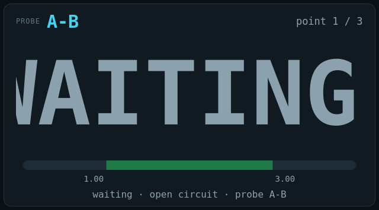 |
| **เหลือง / ส้ม** | ค่ากำลังนิ่ง — **ถือโพรบค้างไว้** | `กำลังนิ่ง… ถือโพรบค้างไว้` | 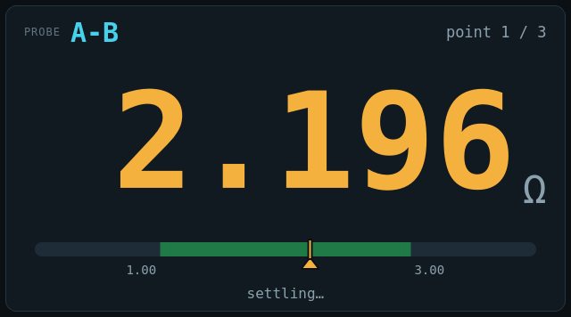 |
| ขาว | ค่านิ่งแล้ว กำลังบันทึก | `ค่านิ่ง · กำลังบันทึก…` | |
| **เขียว** | บันทึกแล้ว — **ผ่าน** สเปค | `บันทึก A-B · PASS → ถัดไป: B-C` | 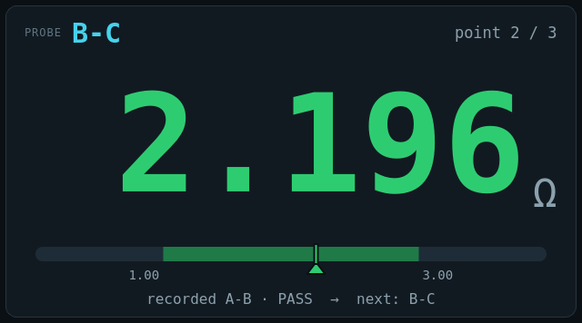 |
| **แดง** | บันทึกแล้ว — **ไม่ผ่าน** สเปค | `บันทึก B-C · FAIL → ถัดไป: D-E` | 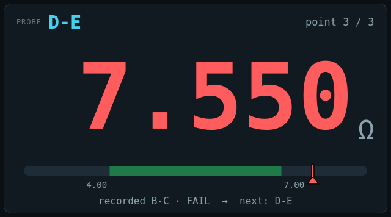 |

**แถบช่วงสเปค** ใต้ตัวเลขช่วยให้เห็นว่าค่าใกล้ขอบสเปคแค่ไหน — ลูกศรอยู่ในแถบสีเขียว = ผ่าน, อยู่นอกแถบ = ไม่ผ่าน

> **สำคัญ:** หลังบันทึก หัวข้อ **จุดวัด** จะเปลี่ยนเป็น **จุดถัดไปทันที** แต่ตัวเลขยังเป็นค่าของ **จุดที่เพิ่งวัด**
> ให้อ่านบรรทัดสถานะ เช่น `บันทึก A-B · PASS → ถัดไป: B-C` = เพิ่งบันทึก A-B ว่าผ่าน ต่อไปให้วัด B-C

---

## 6. โหมดแสดงค่าเมื่อยกโพรบ: ค้างค่า / ปล่อยค่า

เลือกด้วยปุ่มขวาสุดของแถวปุ่มเครื่องมือ (ปุ่ม E หัวข้อ 9) ระบบจำค่าที่เลือกไว้แม้ปิดเครื่อง

| โหมด | ปุ่มแสดง | เมื่อยกโพรบ (วงจรเปิด) | ตัวอย่าง |
|---|---|---|---|
| **ค้างค่า** (Hold, ค่าเริ่มต้น) | **`◼ ค้างค่า`** (`◼ Hold reading`) กรอบสีฟ้า | ค้างค่าล่าสุดไว้เป็น **สีเทา** — `รอวัด · วงจรเปิด · วัดจุด … · ค้างค่าล่าสุด` | 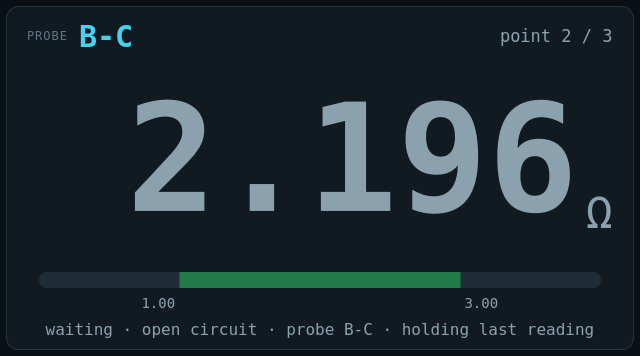 |
| **ปล่อยค่า** (Release) | **`↧ ปล่อยค่า`** (`↧ Release`) | แสดงค่าที่บันทึก **3 วินาที** แล้วเปลี่ยนเป็น **`WAITING`** | 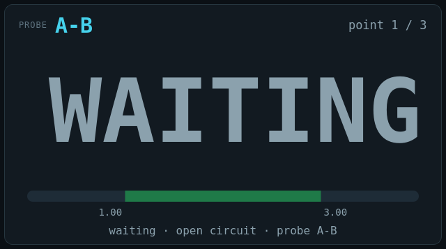 |

> ในโหมดปล่อยค่า ถ้าถือโพรบค้างนานเกิน 3 วินาทีหลังบันทึก จอก็จะแสดง `WAITING` เช่นกัน
> (เครื่องวัดค้างค่าเดิมไว้ ระบบจึงแยกไม่ออกว่ายังแตะอยู่หรือยกแล้ว) — **ผลที่บันทึกไม่หาย** ยังดูได้ที่แถบผลตัดสินและการ์ดจุดวัด

---

## 7. การ์ดจุดวัดและผลตัดสิน

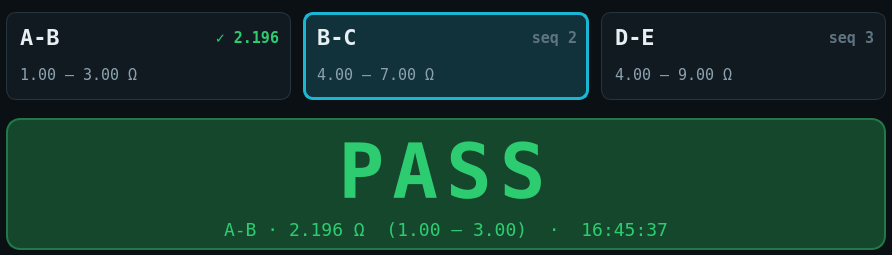

**การ์ดจุดวัด** (หนึ่งใบต่อหนึ่งจุด เรียงตามลำดับการวัด)

- การ์ดที่มี **กรอบสีฟ้า** = จุดที่ต้องวัดตอนนี้
- มุมขวาบนแสดงผลของ **ชิ้นงานปัจจุบัน**: **`✓ 2.196`** (เขียว = ผ่าน), **`✗ 7.550`** (แดง = ไม่ผ่าน), `ลำดับ 2` (`seq 2`) = ยังไม่ได้วัด
- เมื่อเริ่มวัดจุดแรกของชิ้นใหม่ เครื่องหมายของชิ้นก่อนจะถูกล้าง
- **แตะการ์ด** เพื่อข้ามไปวัดจุดนั้นโดยตรง (เช่น ต้องการวัดซ้ำจุดที่ไม่ผ่าน)
- ถ้ามีมากกว่า 4 จุด **ลากนิ้วซ้าย-ขวา** เพื่อเลื่อนดู

**แถบผลตัดสิน** แสดง **PASS** (พื้นเขียว) หรือ **FAIL** (พื้นแดง) ตัวใหญ่ พร้อมรายละเอียด
`จุด · ค่าที่วัด Ω (สเปคต่ำ – สเปคสูง) · เวลา` ของการวัดล่าสุด

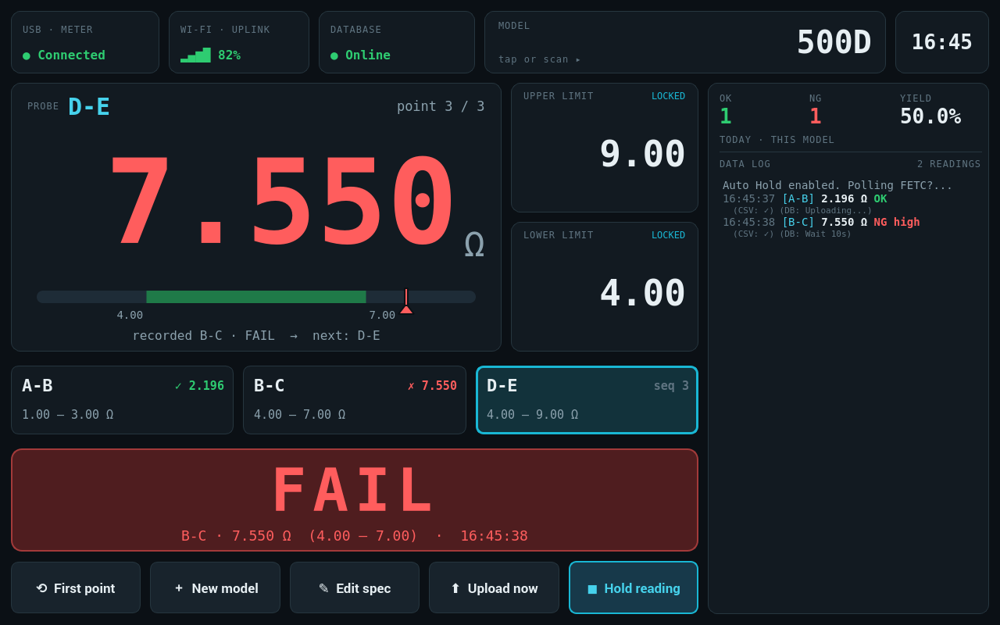

> ตัวอย่างด้านบน: จุด B-C วัดได้ 7.550 Ω เกินสเปค 4.00–7.00 → **FAIL** และการ์ด B-C แสดง ✗ — ระบบเลื่อนไปจุด D-E แล้ว
> ถ้าต้องการวัด B-C ซ้ำ ให้ **แตะการ์ด B-C** ก่อน

---

## 8. แถบสถานะด้านบน

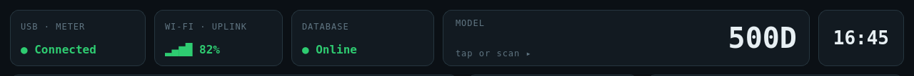

| ช่อง | สถานะ (TH / EN) | ความหมาย / สิ่งที่ต้องทำ |
|---|---|---|
| **USB · เครื่องวัด** | **`● เชื่อมต่อแล้ว`** (`● Connected`) เขียว | เชื่อมต่อเครื่องวัดแล้ว พร้อมวัด |
| | **`◌ กำลังเชื่อมต่อ`** (`◌ Connecting`) ส้ม | กำลังค้นหา / เชื่อมต่อใหม่ — รอสักครู่ |
| | **`○ ไม่ได้เชื่อมต่อ`** (`○ Disconnected`) แดง | ไม่พบเครื่องวัด — ตรวจสายเครื่องวัด HIOKI และเปิดเครื่องวัด |
| **WI-FI · สัญญาณ** | `▂▄▆█ 82%` | เขียว ≥ 70% · ส้ม 40–69% · แดง < 40% · `○ ---` = ไม่มี Wi-Fi |
| **ฐานข้อมูล** | **`● ออนไลน์`** (`● Online`) เขียว | ส่งข้อมูลเข้าฐานข้อมูลได้ปกติ |
| | **`⬆ รอส่ง 3`** (`⬆ 3 queued`) ส้ม | มีข้อมูล 3 รายการรอส่ง |
| | **`○ ออฟไลน์ · 3`** (`○ Offline · 3`) แดง | ติดต่อฐานข้อมูลไม่ได้ ข้อมูล 3 รายการเก็บไว้ในเครื่อง จะส่งเองเมื่อกลับมาออนไลน์ |

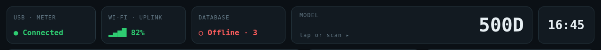

> **ฐานข้อมูลออฟไลน์ไม่ต้องหยุดงาน** — วัดต่อได้ตามปกติ ข้อมูลไม่หาย
> **สัญญาณ Wi-Fi ดี ไม่ได้แปลว่าฐานข้อมูลออนไลน์เสมอไป** — Wi-Fi บอกแค่สัญญาณถึงตัวกระจายสัญญาณ
> ถ้าฐานข้อมูลออฟไลน์นานผิดปกติทั้งที่ Wi-Fi ดี ให้แจ้งผู้ดูแลระบบ (หัวข้อ 14)

---

## 9. ปุ่มเครื่องมือ


| ปุ่ม | ชื่อ (TH / EN) | หน้าที่ |
|---|---|---|
| **A** | **`⟲ จุดแรก`** (`⟲ First point`) | กลับไปเริ่มที่จุดแรกของลำดับ (เช่น เปลี่ยนชิ้นงานกลางคัน) — กดไม่ได้ในโหมดช่วงเดียว |
| **B** | **`＋ รุ่นใหม่`** (`＋ New model`) | ลงทะเบียนรุ่นงานใหม่ (หัวข้อ 10) |
| **C** | **`✎ แก้ไขสเปค`** (`✎ Edit spec`) | แก้ไขสเปคของรุ่นปัจจุบัน (หัวข้อ 10) |
| **D** | **`⬆ ส่งข้อมูล`** (`⬆ Upload now`) | ส่งข้อมูลที่ค้างอยู่เข้าฐานข้อมูลทันที ไม่ต้องรอรอบอัตโนมัติ |
| **E** | **`◼ ค้างค่า`** / **`↧ ปล่อยค่า`** (`◼ Hold reading` / `↧ Release`) | สลับโหมดแสดงค่าเมื่อยกโพรบ (หัวข้อ 6) |

เมื่อมีข้อมูลค้างส่ง ปุ่ม **D** จะมี **กรอบสีส้ม** และแสดงจำนวน เช่น **`⬆ ส่งข้อมูล (14)`**


---

## 10. แก้ไขสเปค / ลงทะเบียนรุ่นใหม่

> สำหรับหัวหน้าไลน์ / วิศวกร — สเปคที่บันทึกจะใช้กับทุกเครื่องที่ใช้ฐานข้อมูลเดียวกัน

- **`＋ รุ่นใหม่`** — เปิดหน้าต่างเปล่าสำหรับรุ่นใหม่
- **`✎ แก้ไขสเปค`** — เปิดหน้าต่างพร้อมสเปคของรุ่นปัจจุบัน

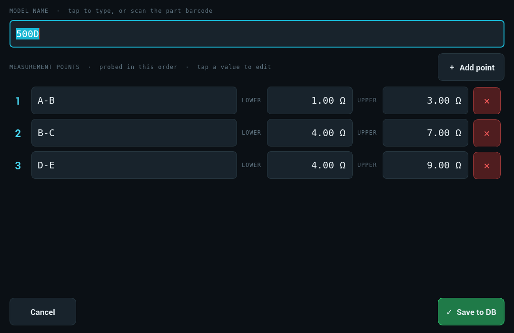

**ขั้นตอน**

1. **ชื่อรุ่น** (MODEL NAME) — แตะช่องเพื่อพิมพ์ด้วยแป้นพิมพ์บนจอ หรือสแกนบาร์โค้ดของชิ้นงาน
2. แต่ละแถว = หนึ่งจุดวัด **เรียงตามลำดับที่ต้องวัด** (เลข 1, 2, 3 ด้านซ้าย)
   - ช่องชื่อ — แตะเพื่อพิมพ์ชื่อจุด เช่น `A-B` (ภาษาอังกฤษ)
   - ช่อง **ต่ำสุด** / **สูงสุด** (LOWER / UPPER) — แตะเพื่อใส่ค่าด้วยแป้นตัวเลข (หน่วย Ω, ทศนิยม 2 ตำแหน่ง)
   - **`✕`** (สีแดง) — ลบแถวนั้น
3. **`＋ เพิ่มจุดวัด`** (`＋ Add point`) — เพิ่มจุดวัดต่อท้าย
4. แตะ **`✓ บันทึกลงฐานข้อมูล`** (`✓ Save to DB`) เพื่อบันทึก หรือ **`ยกเลิก`** (`Cancel`)
5. ถ้าเป็นรุ่นอื่นที่ไม่ใช่รุ่นปัจจุบัน ระบบจะถาม `เปลี่ยนไปวัดรุ่นนี้เลยหรือไม่?` → แตะ **`ใช่`** เพื่อเริ่มวัดรุ่นนั้นทันที

**แป้นตัวเลข**

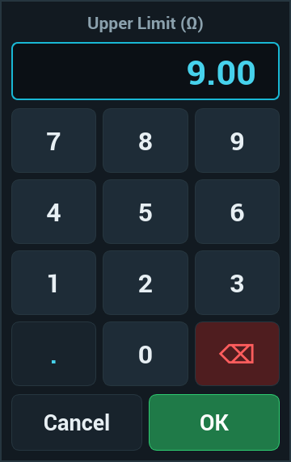

- กดตัวเลขตัวแรก ค่าเดิมจะถูกล้างอัตโนมัติ · **`⌫`** ลบทีละตัว · **`.`** จุดทศนิยม
- ถ้าใส่ค่าเกินช่วงที่อนุญาต แตะ **`ตกลง`** แล้วระบบจะปรับเป็นค่าขอบเขตให้ แตะ **`ตกลง`** อีกครั้งเพื่อยืนยัน

**ระบบจะไม่ยอมบันทึก** (แสดงข้อความสีแดงใต้รายการ) เมื่อ:

| ข้อความ (TH) | ข้อความ (EN) | สาเหตุ |
|---|---|---|
| `ต้องใส่ชื่อรุ่น` | `model name is required` | ไม่ได้ใส่ชื่อรุ่น |
| `ต้องมีจุดวัดอย่างน้อย 1 จุด` | `add at least one measurement point` | ไม่มีจุดวัดเลย |
| `จุดที่ N: ต้องใส่ชื่อจุด` | `point N: name is required` | จุดที่ N ไม่มีชื่อ |
| `จุดที่ N: ชื่อ '…' ซ้ำ` | `point N: duplicate name '…'` | ชื่อจุดซ้ำกัน |
| `จุดที่ N (…): ค่าต่ำสุดต้องน้อยกว่าค่าสูงสุด` | `point N (…): lower must be < upper` | ค่าต่ำสุดไม่น้อยกว่าค่าสูงสุด |

> **ฐานข้อมูลออฟไลน์ขณะบันทึกสเปค:** ระบบแจ้ง **`เก็บสเปคไว้ในเครื่อง`** (`Spec queued`) — สเปคใช้งานในเครื่องนี้ได้ทันที
> และจะส่งเข้าฐานข้อมูลเองเมื่อกลับมาออนไลน์

---

## 11. โหมดช่วงเดียว (ไม่มีลำดับจุดวัด)

รุ่นที่ไม่มีลำดับจุดวัดจะใช้สเปคช่วงเดียวกับทุกการวัด หัวข้อจะแสดง **`ค่าที่วัด ช่วงเดียว`** (`MEASURED single range`)

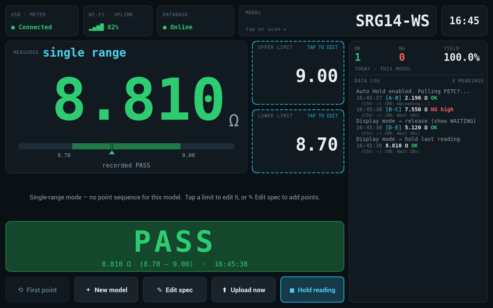

- ช่อง **สเปคสูงสุด / สเปคต่ำสุด** มีกรอบเส้นประสีฟ้าและป้าย **`แตะเพื่อแก้`** (`TAP TO EDIT`) — **แตะเพื่อแก้ค่า** ด้วยแป้นตัวเลข
- ในรุ่นที่มีลำดับจุดวัด ช่องนี้แสดง **`ล็อก`** (`LOCKED`) แก้ไม่ได้ (ต้องแก้ผ่าน **`✎ แก้ไขสเปค`**)
- ถ้าต้องการเปลี่ยนเป็นแบบหลายจุด ให้กด **`✎ แก้ไขสเปค`** แล้วเพิ่มจุดวัด

---

## 12. การบันทึกข้อมูลและการอัปโหลด

ทุกครั้งที่ระบบบันทึกผล:

1. **บันทึกลงไฟล์ในเครื่อง** (ไฟล์รายวัน `YYYYMMDD.csv`) — ข้อมูลไม่หายแม้ไม่มีเครือข่าย
2. **ส่งเข้าฐานข้อมูล** — ถ้าส่งไม่ได้จะเก็บคิวไว้และส่งซ้ำอัตโนมัติ
3. แสดงใน **บันทึกข้อมูล** และนับเข้า **OK / NG / % ผ่าน**

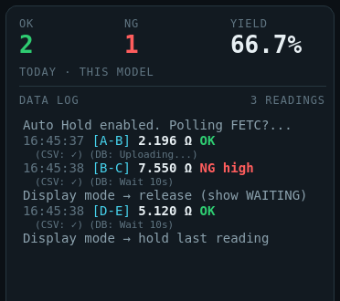

การอ่านบันทึกข้อมูล: `เวลา [จุด] ค่า Ω  OK/NG` และบรรทัดเล็กด้านล่างคือผลการบันทึก

| ข้อความ (TH) | ข้อความ (EN) | ความหมาย |
|---|---|---|
| `(CSV: ✓)` | `(CSV: ✓)` | บันทึกลงไฟล์แล้ว |
| `(DB: กำลังส่ง...)` | `(DB: Uploading...)` | กำลังส่งเข้าฐานข้อมูล |
| `(DB: รอ 10 วินาที)` | `(DB: Wait 10s)` | บันทึกเร็วเกินไป — เก็บในไฟล์ CSV เท่านั้น (ดูหมายเหตุด้านล่าง) |
| `(DB: ยังไม่ตั้งรุ่น)` | `(DB: No Model)` | ยังไม่ได้ตั้งรุ่นงาน |

ข้อความ **สีส้ม** ขึ้นต้นด้วย `!` = คำเตือน เช่น `! ติดต่อฐานข้อมูลไม่ได้ — รอส่ง 12 รายการ ลองใหม่ใน 40 วินาที`
ข้อความ **สีเขียว** ขึ้นต้นด้วย `✓` = สำเร็จ เช่น `✓ บันทึกสเปคแล้ว`

> **ข้อควรทราบ:** ผลที่บันทึกห่างจากการส่งครั้งก่อน **น้อยกว่า 5 วินาที** จะบันทึกลงไฟล์ CSV เท่านั้น
> ไม่ส่งเข้าฐานข้อมูล — หากต้องการให้ทุกผลเข้าฐานข้อมูล ให้วัดแต่ละจุดห่างกันอย่างน้อย 5 วินาที

> **ข้อมูลที่ฐานข้อมูลไม่รับ:** ถ้าบันทึกข้อมูลขึ้น `! ฐานข้อมูลไม่รับ N รายการ (ข้อมูลผิด) — เก็บไว้ที่ failed_uploads.json`
> แปลว่าข้อมูลรายการนั้นผิดรูปแบบ (เช่น ชื่อรุ่นยาวเกินไป) ระบบแยกเก็บไว้ ไม่ทิ้ง และส่งรายการอื่นต่อตามปกติ
> **วัดต่อได้** — แจ้งผู้ดูแลระบบเพื่อแก้ไขข้อมูล (หัวข้อ 14)

**ตัวนับ OK / NG / % ผ่าน** นับเฉพาะ **วันนี้** และ **รุ่นปัจจุบัน** (อ่านจากไฟล์ CSV ของวันนี้เมื่อเปิดโปรแกรมหรือเปลี่ยนรุ่น) และเริ่มนับใหม่เมื่อขึ้นวันใหม่

---

## 13. การแก้ปัญหาเบื้องต้น

| อาการ | สาเหตุที่เป็นไปได้ | วิธีแก้ |
|---|---|---|
| **`○ ไม่ได้เชื่อมต่อ`** ค้าง | สายเครื่องวัดหลุด / เครื่องวัดปิด | ตรวจสาย USB และเปิดเครื่องวัด — ระบบเชื่อมต่อเองภายในไม่กี่วินาที ไม่ต้องปิดโปรแกรม |
| ตัวเลข **สีส้มค้าง** ไม่บันทึก | ค่ายังไม่นิ่ง / แตะโพรบไม่แน่น | กดโพรบให้แน่นและนิ่ง |
| วัดแล้ว **ไม่บันทึก** ทั้งที่ค่านิ่ง | ค่าเท่ากับครั้งก่อนพอดีโดยไม่ได้ยกโพรบ | ยกโพรบออกให้จอแสดง `รอวัด` ก่อน แล้ววัดใหม่ |
| ผลถูกตัดสินด้วย **จุดผิด** | ลำดับเลื่อนไปแล้ว | แตะการ์ดจุดที่ถูกต้อง หรือ **`⟲ จุดแรก`** |
| ขึ้นหน้าต่างให้พิมพ์ชื่อรุ่นตอนวัด | ยังไม่ได้ตั้งรุ่นงาน | พิมพ์ชื่อรุ่นหรือสแกนบาร์โค้ด แล้วแตะ **`OK`** |
| สแกนแล้วขึ้น `ไม่รับบาร์โค้ด — เป็นลิงก์ URL/QR…` | สแกนโดน QR code มอก. หรือลิงก์ | สแกนบาร์โค้ดชื่อรุ่นอีกครั้ง — รุ่นเดิมยังใช้งานอยู่ |
| **`○ ออฟไลน์`** ที่ฐานข้อมูล | เครือข่าย / เซิร์ฟเวอร์ฐานข้อมูลมีปัญหา | วัดต่อได้ ข้อมูลเก็บในเครื่อง — แจ้งฝ่าย IT ถ้านานผิดปกติ, กด **`⬆ ส่งข้อมูล`** เมื่อกลับมาออนไลน์ |
| `! ฐานข้อมูลไม่รับ N รายการ (ข้อมูลผิด)…` | ข้อมูลบางรายการผิดรูปแบบ | วัดต่อได้ — แจ้งผู้ดูแลระบบ (หัวข้อ 14) |
| บันทึกข้อมูลขึ้น `⚠ การสื่อสารกับเครื่องวัดค้าง — กำลังเชื่อมต่อใหม่…` | การสื่อสาร USB กับเครื่องวัดค้าง | ระบบกู้คืนเอง รอสักครู่ ถ้าไม่หายให้ถอด-เสียบสาย USB เครื่องวัด |
| `! โครงสร้างฐานข้อมูลยังไม่อัปเดต…` | ฐานข้อมูลยังไม่ได้อัปเดตโครงสร้าง | แจ้งผู้ดูแลระบบ (หัวข้อ 14) |
| ตัวอักษรไทยเป็น **กล่องสี่เหลี่ยม** | เครื่องยังไม่มีฟอนต์ภาษาไทย | แตะ **EN** เพื่อใช้ภาษาอังกฤษชั่วคราว แล้วแจ้งผู้ดูแลระบบ (หัวข้อ 14) |
| ไม่มีเสียงแจ้ง PASS / FAIL | ลำโพง / ระดับเสียง | ตรวจลำโพงและระดับเสียงของเครื่อง |
| โปรแกรมค้าง / ปิดไปเอง | — | ระบบเฝ้าระวัง (watchdog) จะเปิดโปรแกรมใหม่เองภายในประมาณ 1–2 นาที |

---

## 14. สำหรับผู้ดูแลระบบ

**รีสตาร์ทโปรแกรม** (เช่น หลังอัปเดต):

```bash
sudo systemctl restart hioki-app
```

**อัปเดตโปรแกรม:**

```bash
cd /home/pi/Hioki_data_logger
sudo systemctl stop hioki-app
git pull origin MSW
sudo systemctl start hioki-app
```

**ไฟล์สำคัญ** (ในโฟลเดอร์ `/home/pi/Hioki_data_logger`)

| ไฟล์ | เนื้อหา |
|---|---|
| `YYYYMMDD.csv` | ผลการวัดรายวัน |
| `gui_mode5_config.json` | รุ่นปัจจุบัน, โหมดค้างค่า/ปล่อยค่า, ภาษาหน้าจอ (`"language": "th"` หรือ `"en"`), สเปคที่เก็บสำรองในเครื่อง |
| `pending_uploads.json` | ผลการวัดที่รอส่งเข้าฐานข้อมูล |
| `failed_uploads.json` | ผลการวัดที่ฐานข้อมูลไม่รับ (ข้อมูลผิดรูปแบบ) — แยกเก็บไว้ ไม่ส่งซ้ำอัตโนมัติ |
| `pending_specs.csv` | สเปคที่รอส่งเข้าฐานข้อมูล |
| `model_changes.csv` | ประวัติการเปลี่ยนรุ่นงาน (ใช้กู้คืนรุ่นล่าสุดหลังเครื่องดับ) |
| `watchdog.log` | บันทึกของระบบเฝ้าระวังที่รีสตาร์ทโปรแกรมเมื่อค้าง |
| `i18n.py` | ข้อความบนหน้าจอทั้งภาษาไทยและอังกฤษ — แก้คำแปลได้ที่ไฟล์นี้ แล้วรีสตาร์ทโปรแกรม |

**ฟอนต์ภาษาไทย** — ถ้าตัวอักษรไทยแสดงเป็นกล่องสี่เหลี่ยม:

```bash
fc-list :lang=th                     # ถ้าไม่แสดงอะไร ให้ติดตั้งฟอนต์
sudo apt install fonts-thai-tlwg
sudo systemctl restart hioki-app
```

**ฐานข้อมูลออฟไลน์ค้าง ทั้งที่ Wi-Fi ดี** — ตรวจตามลำดับ:

```bash
# 1. ต่อฐานข้อมูลได้จริงหรือไม่ (เครือข่าย + login + โครงสร้างตาราง)
python3 -c "from insert_resistance2db import check_schema; print(check_schema())"

# 2. ข้อผิดพลาดล่าสุดของการส่งข้อมูล
journalctl -u hioki-app | grep -E "Batch stopped|Upload failed|Parked" | tail -5
```

**แก้ข้อมูลที่ชื่อรุ่นผิด (เช่น สแกนโดน QR มอก. แล้วกลายเป็นชื่อรุ่น)** — ใช้ `clean_url_models.py`:

```bash
sudo systemctl stop hioki-app
python3 clean_url_models.py --replace SRG01-WS            # ทดลองดูก่อน ยังไม่แก้ไฟล์
python3 clean_url_models.py --replace SRG01-WS --apply    # สำรองไฟล์ แล้วเปลี่ยนชื่อรุ่น
sudo systemctl start hioki-app
```

- เปลี่ยน `SRG01-WS` เป็นชื่อรุ่นที่ถูกต้อง — ดูรุ่นที่ใช้ก่อนสแกนผิดได้จาก `model_changes.csv`
- สคริปต์จะ **สำรองไฟล์ก่อนเสมอ** (`*.bak_วันที่_เวลา`) แล้วเปลี่ยนชื่อรุ่นใน `pending_uploads.json`
  ดึงรายการใน `failed_uploads.json` กลับเข้าคิว และแก้รุ่นปัจจุบันใน `gui_mode5_config.json`
- ถ้าไม่ใส่ `--replace` สคริปต์จะย้ายรายการชื่อรุ่นผิดไปไว้ที่ `failed_uploads.json` แทน
- ไฟล์ CSV รายวันไม่ถูกแก้ — ยังแสดงชื่อรุ่นเดิมที่ผิด

**คีย์ลัด** (ใช้คีย์บอร์ดจริง สำหรับทดสอบ): **Ctrl+P** แสดง PASS · **Ctrl+F** แสดง FAIL (ทดสอบหน้าจอและเสียง ไม่บันทึกข้อมูล)

**ปรับเวลา `WAITING` ในโหมดปล่อยค่า:** แก้ค่า `RELEASE_AFTER_S` (ค่าเริ่มต้น 3.0 วินาที) ในไฟล์ `main.py` แล้วรีสตาร์ทโปรแกรม

> รายละเอียดการติดตั้ง ฐานข้อมูล และการตั้งค่าเพิ่มเติม ดูที่ [README.md](README.md)
